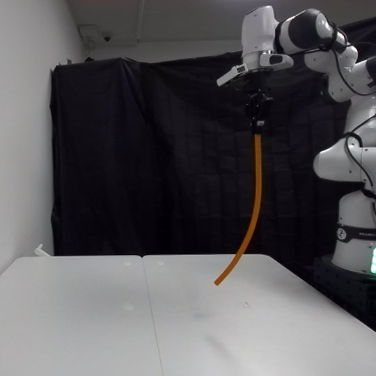
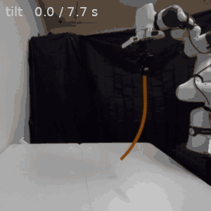
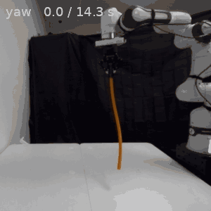
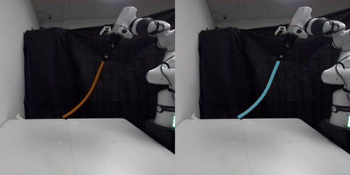
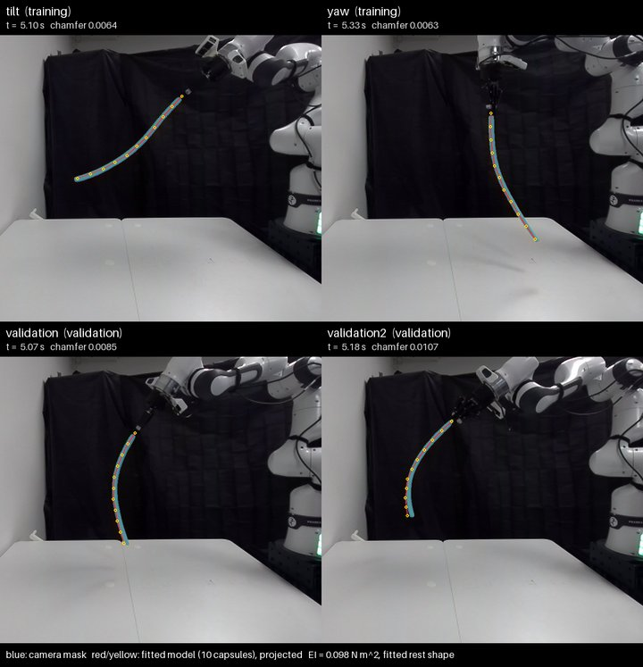

<!--
SPDX-FileCopyrightText: Copyright (c) 2026 The Newton Developers
SPDX-License-Identifier: CC-BY-4.0
-->

# Driven cable

This recipe calibrates the rest centerline and the bending stiffness of a free-hanging
cable, modeled as a VBD rod. A robot gripper holds one end of the cable and moves it.
It does not need 3D measurements of the cable.

The recipe needs:

- RGB videos of the cable from one fixed camera
- The camera intrinsics and extrinsics (the camera pose relative to the robot base)
- The gripper pose during each video, on the same clock as the images
- The cable length, mass and diameter, and the cable length inside the gripper

The [driven cable example](../../../examples/cable_driven/README.md) implements the
recipe. Use the recipe to calibrate your own cable, or to understand how the example
data was made.

{align="center"}

## What this recipe calibrates

The example fits a VBD rod of 10 capsules to a real cable. The robot gripper
holds one end of the cable and moves it. The other end hangs free. A kinematic capsule
follows the recorded gripper pose, and the rod follows it. One camera observes the
cable. The fit searches these parameters:

| Parameter | Unit | Bounds in the example |
|---|---|---|
| Bending rigidity EI | N m² | 0.05 to 5, log scale |
| Rest shape: one bend pair `rest_x_k`, `rest_y_k` per joint, 20 values | m, arc displacement at the cable end | ±0.4 rad times the cable length beyond the joint |

All other material parameters are fixed. The rest shape is fitted because a real cable
is not straight when no load is on it.

The example makes these assumptions. Use the recipe only if your setup agrees with them.

- The gripper holds the cable rigidly. The model does not fit slip or clamp compliance.
- The cable does not collide with the environment or the robot. The model has no
  contact.
- The robot pose and the camera images have one common clock.
- The camera is fixed during the recording. Its pose relative to the robot base is known.
- One camera sees the cable from one direction. The fit gets depth information only
  from perspective and from motions that turn the cable toward or away from the camera.
- The fitted values are equivalent parameters for 10 capsules. They are not material
  constants. Do a new calibration if you change the capsule count.

## What you need

| Item | Use |
|---|---|
| The cable | The calibration object. A color that contrasts with the background makes segmentation easier. |
| A robot arm with a gripper | Holds the cable and moves it along a known trajectory |
| A dark, plain backdrop | The background behind the cable |
| A calibrated camera on a fixed mount | Records the cable. The example uses a ZED 2i stereo camera and only its left color image. |
| A scale | Cable mass |
| A ruler and calipers | Cable length, grip length and diameter |
| A Linux computer with an NVIDIA GPU | Simulation, see [Run the example](#run-the-example) |

In the example, the camera is mounted approximately 1 m from the robot.

## Measure the cable directly

Do not fit quantities that you can measure. Measure these values and write them into
the configuration and the recordings:

| Quantity | Example value | Where it goes |
|---|---|---|
| Total cable length | 0.5 m | `asset.cable_length_m` in the configuration |
| Cable mass | 0.174 kg | Divide by the length: `linear_density` 0.348 kg/m |
| Diameter | 16 mm | `radius` 0.008 m |
| Length inside the gripper | 0.02 m | `attachment.clamp_position_m` in each recording |
| Offset from the robot flange to the grasp point | 0.16 m along the flange z axis | Added to the robot pose when you write the drive |

The example does not fit the bend damping, the stretch, shear and twist rigidities, and
the twist damping. They are fixed numerical settings, not measurements:

| Parameter | Value | Reason |
|---|---|---|
| Stretch and shear rigidity EA, GA | 400 N | Stiff enough that the cable does not stretch significantly. With 20 N, the cable bounced along its length during the settle and failed the numerical qualification. |
| Bend damping | 0.02 N m² s | The cable settles in fewer than 70 frames over the EI bounds. With 0.002 it swings for a long time. With 0.2 and more it creeps. |
| Twist rigidity GJ, twist damping | 0.04 N m², 0.002 N m² s | Not fitted in the example |

## Record the data

Hold the cable in the gripper with the free end down. Put the camera in front of the
robot, so that the whole cable is in the image during all motions. Record the robot
pose and the camera images together.

The example has four recordings:

| Recording | Set | Duration | Observations | Motion |
|---|---|---:|---:|---|
| `tilt` | Training | 7.7 s | 149 | The gripper tilts about 54 degrees in the image plane. |
| `yaw` | Training | 14.3 s | 276 | The gripper turns about the vertical axis. This turns the curvature of the cable toward and away from the camera. |
| `validation` | Validation | 7.7 s | 154 | The same tilt, with the gripper turned half a turn about its axis. The curvature of the cable faces the other way. |
| `validation2` | Validation | 5.8 s | 114 | A repeat of `validation` |

{width="49%"}
{width="49%"}

```{important}
The training set needs both motions. In each motion alone, a change of the rest shape
can reproduce almost all of the effect of the bending rigidity on the silhouette, so
neither recording alone identifies both. The tilt and the yaw load the cable
differently relative to gravity and the camera, so their trade-offs differ. Together
they identify both: in the sensitivity analysis of the example, the information on the
bending rigidity is 30 to 40 times larger with both recordings than the sum of the two
alone.
```

Tips:

- Move slowly enough that the cable does not swing hard. The example does not fit the
  damping, so fast swings add error that the fit cannot remove.
- Start each recording with the cable at rest. The simulation settles the cable for
  2 s at the first recorded pose, then starts the motion.
- The cable must not collide with the environment or the robot during the whole motion.
- Use a motion that turns the cable about the vertical axis (like yaw). In the image
  plane alone, a curvature toward the camera and a curvature away from it look the same.
- Record motions for validation that the training does not contain, for example the
  same tilt with the cable turned around.

For the example, the data was recorded with `ros2 bag record` and stored as one ROS 2
bag per motion. A custom script then converted each bag to the recording format of the
example (see [Process the recordings](#process-the-recordings)). The bags hold these
streams:

| Stream | Content |
|---|---|
| Robot state | The flange pose in the robot base frame, at about 1 kHz |
| Camera | The rectified left color image at 60 frames per second, and the camera intrinsics |
| Static transforms | The camera pose relative to the robot base, from an eye-to-hand calibration |

### Calibrate the camera pose

For the example, the following methods were used for the eye-to-hand calibration. You
can use other methods.

- **Target:** one AprilTag (family 36h11, 0.1 m edge length), attached rigidly to the
  robot flange.
- **Tag pose:** OpenCV ArUco detection with AprilTag corner refinement in the rectified
  image, then the OpenCV perspective-n-point solver with `SOLVEPNP_IPPE_SQUARE`.
- **Robot pose:** the flange pose in the robot base frame at the time stamp of the image.
- **Samples:** 30 robot poses with the tag in view.
- **Solver:** OpenCV `calibrateHandEye` with the Park method. For the eye-to-hand case,
  the inverted robot poses are the input.
- **Result:** the camera pose in the robot base frame, published as a static transform.

## Process the recordings

For the example, a custom script extracted the frames from each bag into the recording
format. It did these steps:

1. Export the color frames with their time stamps.
2. Segment the cable. We recommend a video segmentation model, for example SAM 2. The
   example used the SAM 2 video predictor (`sam2.1_hiera_large`): click the cable in the
   first frame and let the predictor track it through the video.
3. *Optional.* Keep every third frame, which gives 20 observations per second. Fewer
   observations make each rollout cheaper to score.
4. *Optional.* Crop the frames and masks to the region of the cable, 720 × 720 pixels.
   Shift the principal point of the camera by the crop offset.
5. Write the drive: the robot poses with times relative to the first kept frame, and
   the flange-to-grasp offset applied.
6. Convert the camera pose to the Newton camera frame (+X right, +Y up, −Z forward).
   ROS uses the optical frame (+X right, +Y down, +Z forward).



Check the masks before you fit. A mask that also covers a part of the robot or loses
the cable tip adds a constant error in those frames.

## Arrange the data for the example

Put each recording in its own directory. The directory name does not matter; the
experiment `id` names the recording.

```text
recordings/
  tilt/
    recording.json
    frames/00000.jpg ...
    masks/00000.png ...
  yaw/
  validation/
  validation2/
```

`recording.json` holds these fields. All lengths are in meters, all times in seconds.

| Field | Content |
|---|---|
| `experiment.id` | Recording name, for example `tilt` |
| `experiment.times` | Observation times, from the first kept frame. Each observation is taken at the solver step nearest to its time. |
| `settings.fps` | Simulation frame rate, 60 in the example |
| `settings.attachment.transform` | Pose of the grasp frame in the TCP frame: position and quaternion (x, y, z, w). The cable runs along +Z of the grasp frame. Identity in the example. |
| `settings.attachment.clamp_position_m` | Cable length inside the gripper |
| `drive.times_s`, `drive.positions_m`, `drive.quaternions_xyzw` | TCP poses in the robot base frame. The times must be strictly increasing and cover all observation times. |
| `camera.position_m`, `camera.quaternion_xyzw` | Camera pose in the robot base frame, in the Newton camera frame |
| `camera.intrinsics` | `fx`, `fy`, `cx`, `cy` in pixels of the stored images. The images must be undistorted. |
| `images.masks` | One mask per observation, paths relative to the recording. Nonzero pixels are cable. |
| `images.rgb`, `source` | The frames and a description of where the data came from. The example does not read them. |

[data.py](../../../examples/cable_driven/data.py) reads the recordings.

## Run the example

Install the package with the pinned Newton version and the extras for CMA-ES and the
cable examples:

```bash
pip install -e ".[newton,cma,cable]"
```

Then build the calibration and run it:

```bash
python -m examples.cable_driven.run --recordings PATH          # build only, no simulation
python -m examples.cable_driven.run --recordings PATH --run    # calibrate
```

`--config` selects another configuration. The default is
[configs/orange_cable.json](../../../examples/cable_driven/configs/orange_cable.json).

| Requirement | Value used in the example |
|---|---|
| Operating system | Linux x86_64 |
| Python | 3.12 |
| Newton | Commit `d37f4d3` |
| Warp | 1.17.0 |
| GPU | One CUDA GPU. The example ran on an 8 GB laptop GPU. |
| Time before the search | About 10 minutes: baseline, numerical qualification and sensitivity analysis |
| Time per search generation | About 70 s for 24 candidates on both training recordings |
| Search length | Up to 150 generations. The full run took about 3.5 hours. |

To fit your own cable, copy the configuration and change these values:

| Key | Unit | Change it when |
|---|---|---|
| `asset.cable_length_m` | m | Always: the total cable length |
| `fixed_parameters.linear_density`, `radius` | kg/m, m | Always: from your measurements |
| `fixed_parameters.stretch_rigidity`, `shear_rigidity` | N | The simulated cable stretches significantly, or bounces along its length |
| `parameters` (EI bounds and baseline) | N m² | Your cable is much stiffer or softer |
| `rest_shape.max_angle_rad` | rad | Your cable has a stronger natural curvature |
| `discretization.num_elements` | – | You need more or fewer capsules. This changes the meaning of the fitted values. |
| `numeric_settings.settle_frames` | frames | The cable is not at rest when the motion starts |
| `scale` | cable lengths on screen | The expected chamfer score of a good fit changes, for example with a thicker cable on screen |
| `train`, `validation` | – | Your recordings have other names |
| `validator.max_objective`, `max_error` | scales | You need a stricter or looser acceptance |

## Interpret the results

A run prints its result and writes a run directory. The
[quick start](../../quickstart.md#understand-the-result) explains the result fields and
the files.

The objective is the mean squared chamfer score in units of `scale` (0.01). The chamfer
score of one frame is the mean distance between the projected model axis and the mask,
divided by the length of the mask on screen. A perfect fit does not score zero, because
the mask has the width of the cable and the model is a line.

Read the result in this order:

1. **Acceptance.** `accepted` means that the fit passed the training, validation and
   numerical checks.
2. **Numerical qualification.** The run simulates three candidates with 16 and with 32
   substeps. The change must stay below 0.5 scales. In the example the largest change
   was 0.08.
3. **Identifiability.** The rest bends near the free end change the silhouette little.
   Their singular values are about 6e-4 of the largest. The example sets
   `rank_tolerance` to 1e-4 to keep them in the search. With the default (1e-3), the
   run stops with `inconclusive_parameters`.
4. **Training and validation scores.** The validator accepts a recording when its
   objective is at most 4.0 and its largest error, the worst single frame, is at most
   5.0. The objective is in scales² and the largest error in scales. One scale is
   0.01 cable lengths on screen.

The reference fit of the example:

| Recording | Set | Objective [scales²] | RMS chamfer score [cable lengths] | RMS chamfer score [px], approximately |
|---|---|---:|---:|---:|
| tilt | Training | 0.441 | 0.0066 | 2.0 |
| yaw | Training | 0.472 | 0.0069 | 2.0 |
| validation | Validation | 0.710 | 0.0084 | 2.2 |
| validation2 | Validation | 1.323 | 0.0115 | 2.8 |

The pixel values use the mean mask length on screen, 240 to 300 px in the 720 × 720
frames. The cable mask is about 13 px wide in these frames.

The run is accepted. The fitted EI is 0.098 N m². The search used all 150 generations
(about 3.6 hours in total); the best candidate is from generation 149. The numerical
retest of the result at 32 substeps changed the features by at most 0.008 scales.



Look at the overlay, not only at the numbers. These patterns point to a cause:

| Pattern | Likely cause |
|---|---|
| The model is offset from the mask in all frames, also at rest | Camera pose or intrinsics, or the flange-to-grasp offset |
| The model lags behind the mask, or leads it, during fast motions | A delay between the images and the robot poses |
| The model shape is right in training and wrong in a validation recording with the cable turned around | The rest shape is fitted to the view of the training recordings. Add a recording that turns the cable toward the camera. |
| The cable swings longer in the model than in the images, or shorter | The fixed bend damping does not match the cable |
| The baseline fails qualification, or does not settle | See the failure modes below |

Failure modes seen while the example was made:

| Symptom | Cause | Fix |
|---|---|---|
| Qualification fails at 32 substeps, or the settle does not converge | The stretch rigidity is too low, so the cable bounces along its length | Raise EA and GA. |
| The settle does not converge for curved rest shapes | The bend damping is too low | Raise the bend damping, or raise `settle_frames` |
| The run stops with `inconclusive_parameters` | Weak rest bends near the free end | Lower `rank_tolerance`, or fit fewer rest bends |
| The search stops with `stagnation` while the median score still falls | A lucky candidate early in the search, and `patience` too short | Raise `decision.patience` |
| `presentation: ValueError: no comparable position traces for USD export` in the errors | The chamfer traces have no positions to export | No action. The fit is not affected. |

## Use the result

An accepted run writes `release/asset.json`, `release/template.json` and
`release/manifest.json`. Keep the three files together. The fitted values are valid
only for the same capsule count, the same clamp layout, the same numerical settings,
and slow motions similar to the recordings. The bend damping is not calibrated.

> **Note:** There is no export of the fitted values to a USD cable asset yet. See
> [issue #6](https://github.com/newton-physics/newton-calibration/issues/6).

## Reference data

The four recordings of the example are in the Hugging Face dataset
[newton-physics/calibration-data](https://huggingface.co/datasets/newton-physics/calibration-data).
They have 693 observations in total, with frames and masks. Download them and give
the directory to `--recordings`:

```bash
hf download newton-physics/calibration-data --repo-type dataset --local-dir calibration-data
python -m examples.cable_driven.run --recordings calibration-data/cable_driven --run
```
