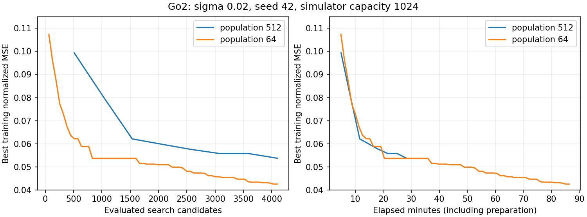

<!--
SPDX-FileCopyrightText: Copyright (c) 2026 The Newton Developers
SPDX-License-Identifier: CC-BY-4.0
-->

# Go2 actuator sysid: population, sigma and search budget

This report records the completed public-data experiments, including rejected and
previously unvalidated runs. The best tested 4,096-candidate configuration was
population 64, initial sigma 0.02, seed 42: training normalized MSE **0.04253024**
and held-out normalized MSE **0.03427037**. Its frozen candidate passed subsequent
training, held-out, timestep-refinement and fresh-process replay checks. This is
model-dependent actuator system identification on public recordings, not a
hardware qualification or a statistically established optimum.

[results.json](results.json) contains unrounded scores, generation curves, selected
gains, original acceptance states, supplemental validation and SHA-256 hashes of
retained historical summary artifacts. Raw recordings, meshes, simulation traces
and optimizer checkpoints are not included. [README.md](README.md) documents the
portable download and unattended training commands.

## Fixed protocol

| Item | Value |
| --- | --- |
| Data | Public suspended Go2 excitation captures; training 1/2, validation 3 |
| Data revision | `55d736ecc1cfbaf40faa39c46d77ba7b3a3c0d53` |
| Model revision | MuJoCo Menagerie `370c43965323c0944b433b202aac5058b5f907a9` |
| State/control | 12 rotary joints, measured q/qd initial state, native stateless position PD |
| Model assumptions | Fixed level base, gravity −9.81 m/s², no contacts, fixed inertias/armature/Coulomb friction; passive damping zero |
| Parameters | 12 Kp and 12 Kd; all start at 25 N·m/rad and 1.5 N·m·s/rad |
| Bounds | Kp [12.5, 50], Kd [0.25, 4] |
| Force limits | Hip/thigh ±23.7 N·m; calf ±45.43 N·m |
| Control clock | Nominal 5 ms, zero-order-held position targets; native PD feedback every physics step |
| Physics | 0.5 ms, refinement 0.25 ms, feature tolerance 0.0002 |
| Observations | Train: 1,201 samples/capture; validation: 4,800; all 4,800 commands retained |
| Scales | Position 0.05 rad; velocity 0.5 rad/s |
| Physical gates | Per joint/record: position RMSE ≤0.05 rad, maximum ≤0.15 rad; velocity RMSE ≤0.5 rad/s, maximum ≤1.5 rad/s |
| Normalized gates | Objective ≤1; maximum normalized error ≤3 |
| Backend | Newton `SolverMuJoCo`, CUDA, separate worlds; CMA-ES and scoring on CPU |
| Cloud capacity | 1,024 worlds, independently of optimizer population |
| Cloud device | NVIDIA RTX5880-Ada-48Q, 48 GiB, driver 570.172.18 |
| Software | Python 3.13.5; Newton `d37f4d3d341ccce1e06a1dff21e9a054759b4855`; Warp 1.17.0; MuJoCo/mujoco-warp 3.12.0; cma 4.5.0; NumPy 2.5.4; SciPy 1.18.1; trimesh 4.12.2; Pillow 13.0.0 |

Sources and licenses are pinned in [sources.json](sources.json); model changes are
explicit in [recipe.json](recipe.json). Original nominal training loss is
**0.1338763281436679**. The objective averages squared scale-normalized residuals
within each training capture, then gives the two captures equal weight. A lower
aggregate score does not guarantee every physical error improves.

Sigma is measured in normalized parameter coordinates. Initially sigma 0.02
corresponds approximately to Kp standard deviation 0.75 and Kd 0.075 before
boundary handling; sigma 0.05 gives 1.875 and 0.1875; sigma 0.2 gives 7.5 and 0.75.
CMA-ES adapts sigma and its covariance; the initial value is not a constant physical
perturbation throughout the run.

## Initial investigation: why 1,024 candidates did not improve the baseline

The earlier local GPU run used capacity 512, population 128, sigma 0.2 and eight
generations. All 1,024 candidates were valid, but none improved the initial loss.
The selected baseline passed the configured gates; `accepted` therefore did not
mean optimization had improved it. Local timing is not compared with cloud timing.

The archived diagnosis recomputed scores (maximum discrepancy 1.78e-14), checked
parameter readback (maximum relative discrepancy 5.94e-8), reproduced CMA-ES
ask/tell, and compared the best sampled candidate on CPU/GPU (maximum state
difference 4.29e-6). It found no binding or scoring defect in those checks.
Twenty-four of 48 single-coordinate probes improved the baseline. In matched
64-candidate scale probes, sigma 0.02/0.05/0.1/0.2 produced respectively 27/8/1/0
improving candidates. This supported trying a narrower initial distribution.
The optimizer mean was not itself evaluated by the original lifecycle; its
unscored estimate must not be treated as the delivered candidate.

Two controlled cloud runs then kept population 128, eight generations, 1,024
candidates, seed 42 and the physical protocol fixed:

| Initial sigma | Training loss | Validation loss | Original result | Elapsed |
| --- | ---: | ---: | --- | ---: |
| 0.02 | 0.05929705 | 0.04688647 | accepted | 20.06 min |
| 0.05 | 0.06077281 | not evaluated | rejected_training | 17.29 min |

Sigma 0.05's best-loss candidate exceeded the training maximum-velocity gate:
RL calf **1.50844407 rad/s >1.5**, or normalized maximum **3.01688814 >3**.
The lifecycle did not replace it with a different feasible candidate. Its final
sigma was 0.06252, versus 0.04250 for the 0.02 run. The target of 0.04 was not reached.

## Overnight matrix: 2,048 candidates per configuration

All matrix runs used seed 42. Early target stopping and patience were disabled;
the full-generation budget was held constant in candidate count. Cells show the
selected training loss, including the rejected candidate.

| Population | Generations | sigma 0.01 | sigma 0.02 | sigma 0.05 | Elapsed range |
| ---: | ---: | ---: | ---: | ---: | ---: |
| 64 | 32 | 0.05143162 | **0.05091950** | 0.05807273 | 47.95–48.26 min |
| 128 | 16 | 0.05554990 | 0.05429118 | 0.06077281 (rejected) | 30.11–32.29 min |
| 256 | 8 | 0.05656315 | 0.05709595 | 0.06036998 | 24.04–24.27 min |
| 512 | 4 | 0.06787493 | 0.05983623 | 0.06126701 | 19.83–20.05 min |

The 128/0.05 run retained the same rejected candidate after another eight
generations. The other selected candidates passed training gates. Screening
runs deliberately contained training evidence only, so their original core
status was `unvalidated`; do not interpret the table as twelve accepted releases.
Selection for further checks used training outcomes, not validation scores.

Population 64/sigma 0.02 was repeated with two additional seeds. All three frozen
candidates passed separate final validation and numerical/replay checks:

| Seed | Training loss | Held-out loss |
| ---: | ---: | ---: |
| 42 | 0.05091950 | 0.03775899 |
| 7 | 0.05060488 | 0.03939967 |
| 123 | 0.05182441 | 0.03911215 |

Training mean was 0.05111626, sample standard deviation 0.00063312. This repeats
one selected setting; it is not a multi-seed comparison of every population.
Fourteen searches completed, totaling 28,672 search candidates. Two planned
4,096-candidate jobs were skipped to respect the overnight deadline, then run
separately below. No run reached training loss 0.04. An offline patience=4 check
would have stopped population 64/sigma 0.02 after 17 generations and missed a
further 5.1% reduction; the analogous population 128 check would have missed 8.4%.
These are retrospective stopping diagnostics, not additional search runs.

## Extended budget: 4,096 candidates

Both extensions started again from nominal gains, seed 42 and sigma 0.02. They
were complete reruns with larger budgets, not continuation from saved CMA state.

| Population | Candidates | Generations | Training loss | Held-out loss | Search run elapsed |
| ---: | ---: | ---: | ---: | ---: | ---: |
| 64 | 2,048 | 32 | 0.05091950 | 0.03775899 | 48.26 min |
| 64 | 4,096 | 64 | **0.04253024** | **0.03427037** | 89.46 min |
| 512 | 2,048 | 4 | 0.05983623 | 0.04717625 | 19.98 min |
| 512 | 4,096 | 8 | 0.05374133 | 0.04022122 | 33.29 min |

Doubling candidates reduced training/validation loss by **16.48%/9.24%** at
population 64 and **10.19%/14.74%** at population 512. The three additional frozen
candidate validations (both extensions and the earlier population 512 candidate)
passed the original gates. Elapsed times above include each screening lifecycle
but exclude separately executed supplemental validation; they are not full
end-to-end delivery latency.

The 64/4,096 candidate's worst held-out position RMSE/maximum were
0.02001029/0.06479359 rad; velocity RMSE/maximum were 0.15711007/0.83776490 rad/s.
For 512/4,096 these were 0.02197869/0.06181169 rad and
0.19220127/0.96398453 rad/s. All worst errors occurred on RL calf. At population
64, position errors slightly worsened relative to 2,048 candidates while velocity
errors improved; aggregate loss improvement is not uniform channel improvement.

### Preserved diagnostic failure and subsequent validation

The original extension script required score equality within 1e-10 for the first
2,048 candidates. Maximum discrepancies were **6.98e-9** (64) and **8.34e-8** (512).
That diagnostic failed and the original automation skipped held-out replay. The
historical failure and original `unvalidated` statuses are retained.

A later audit found identical trial identities, valid/gate results and generation
rankings. For all 32/4 prefix checkpoints, optimizer mean, covariance, sigma and
path state had exactly zero differences. Supplemental validation then replayed the
frozen candidates without searching or relaxing physical/numerical gates. Final
refinement feature differences were 0.00010853 and 0.00010656, below 0.0002;
fresh-process objective differences were approximately 3.1e-15. Passing these
separate checks does not retroactively change the original prefix result.

## Interpretation and next choices

At a fixed candidate budget, smaller populations provide more opportunities to
update CMA-ES's distribution: 64 versus eight updates for 4,096 candidates. That
is a plausible explanation for this case's better population-64 outcome; population
also changes CMA-ES recombination and covariance learning, so it is not an isolated
experiment on update count alone.

At a fixed eight generations, population 512 achieved 0.05374133 using 4,096
candidates, while population 64 achieved 0.06218709 using only 512. At roughly
30 minutes, the best available losses were approximately 0.05366480 and
0.05374133, respectively. The evidence supports better **candidate efficiency**
for population 64 here, not an unconditional speed advantage. Large simulator
capacity does not require a large optimizer population.

For this existing dataset, population 64/sigma 0.02 and a 4,096-candidate budget
are a reasonable next baseline when quality per candidate matters. Population
512 offers faster completion at the tested budget. Neither extended curve had
established a final plateau (last improvements at generations 63 and eight).
Further comparisons should predeclare a wall-time budget, repeat both settings
across seeds, and use new independent recordings for any hardware claim.

The historical holdout has already been inspected repeatedly; it is not a fresh
blind test. Actual sensor/control timing, transport delay, actuator dynamics and
mount uncertainty are not identified. The local sensitivity rank of 24 and the
successful timestep qualification establish only the tested local/numerical
conditions. Synthetic recovery tests, SolverMuJoCo bridge/GPU tests, and these
public measured-record results should remain separate evidence categories.
